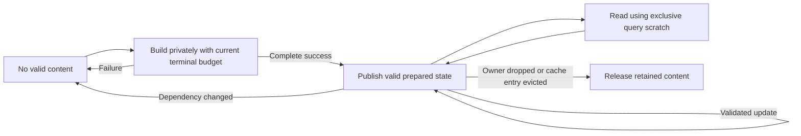

# Preparation, validity and sequence ownership

[Design index](README.md) / [Resource contracts](02-resource-contracts.md)

Retained capacity, valid prepared content and a sequence's evolving state have
different dependency rules. This design makes those rules explicit in existing
owners. It does not introduce a process-wide cache or public session API.

## Four kinds of reuse

| Reuse | Validity condition | Owner / end of use |
| --- | --- | --- |
| Typed capacity | Layout/type/capacity compatible; previous mutable use is over; initialize new reads | Terminal or bounded reuse scope |
| Structural preparation/plan | The structure, dimensions, layout and options it actually depends on match | Source/algorithm owner; invalidate on a changed dependency |
| Computed numeric/algebraic content | Data, ordered basis, field/inner product, policy and required factor form match | Domain prepared owner; discard or validated update on change |
| Warm vectors | Coordinates map validly into the current problem and current solver accepts them | Sequence owner; evaluate again under the current operator |

These are dependency categories, not four required public types. In particular,
different matrices can reuse the same capacity or structural plan without sharing
a numeric factor. A warm start can cross changing operators without making old
eigenvalues or residuals valid current answers.

## Dependency records are owner-specific

| Prepared owner | Dependencies that matter | State that must not be confused with it |
| --- | --- | --- |
| Prepared graph/source | Borrowed or owned input, construction rules, caps, sampling/provenance and layout | A narrower one-shot query or arbitrary caller callback to replay |
| Serial critical primal/dual | Entire supplied complex, filtration order, F2 arithmetic and serial support form | Unrelated PH decompositions or a query-local U residual |
| F2 query window/run | Its ordered chain window, exact matrices and existing context/run binding | Another run's numerically equal indices |
| Real incidence snapshot | Signed incidence, ordered retained degrees/bases and numerical interpretation | Action output or solver residual blocks |
| Persistent upper factor, candidate only | Exact representative/row-selection dependencies, endpoint/source/basis, numeric data and projection policy | Current pair lower term, warm vectors and result metadata |

Use an immutable borrow to bind source lifetime where possible. An owned
snapshot owns its actual dependencies. Preserve existing `Arc` run bindings
where they already protect query compatibility. Store cheap construction-time
facts only when a later consumer needs them. Do not add whole-input hashing or
a universal global identity layer to simulate a lifetime the type already owns.

## Prepare, publish, use and invalidate



Immutable read/query failure leaves previously valid content usable. Failed new
preparation never publishes an entry. A mutable incremental update must consume
the old snapshot on failure, stage only a bounded necessary delta, or mark the
state invalid before later reads. Choose the smallest mechanism preserving the
existing public failure contract. Copying a complete factor for every update is
not the default transaction mechanism.

Scratch may remain dirty after any failure. Reinitialization belongs to its next
use, and capacity can remain retained. A repeated public query creates a fresh
budget while its nested lazy preparation shares that query's budget.
[CriticalSetWorkspace][critical] already commits complete transpose caches and
keeps bounded U rows temporary; preserve this behavior rather than replacing it.

## Candidate persistent factor boundary

Observed in [PR 160's operator][operator]: `reuse_upper` creates the current
`(K,K)` operator, clears/replaces upper state, and copies cached factors from
another complete operator. [Relevant-pair spectra][pairs] cache complete
operators as the upper-factor carrier and rebuild the requested current lower
boundary. This is a concrete boundary to evaluate after the candidate code is
available on the implementation base.

The proposed split is logical before it is a new public type:

```text
reusable upper content
  signed upper incidence, fixed projection representation, required diagnostics
current pair content
  lower incidence, domain/target basis metadata and pair/source context
execution resources
  upper temporary, projection coefficients, lower temporary and solver scratch
sequence state
  representative schedule, bounded upper retention and mapped warm vectors
```

A private view into an owned cached factor may suffice. Prefer move/borrow over
copy where lifetimes permit; use shared ownership only if real simultaneous
consumers require it. Returned eigenpair results remain detached owned data.
Do not make them borrow cache entries that the next request can overwrite/evict.

Inventory both dense row-space and optional compact representations and all
consumers, including updates/diagnostics. Remove duplicate retained content only
if those consumers no longer need it and the original projection/numerical
contract still holds. Preserve current original-pair order, duplicates, scales
and lower terms even when an upper representative is shared.

## Fixed endpoint and warm-vector rules

Candidate `restrict_start` consumes a snapshot and moves its start backward at a
fixed endpoint. Preserve nonincreasing start, immutable source-coordinate order,
newly excluded constraints, valid lower truncation and numerical rejection rules.
This is not online endpoint insertion or arbitrary bidirectional editing.

Warm transfer retains only vectors and the information needed to map them into
the current basis. Validate length/coordinate mapping; orthogonalize and evaluate
under the current action; recompute Ritz values, original-coordinate residuals
and acceptance. An invalid optional warm seed can be excluded by a defined
eligibility rule; it cannot suppress a genuine terminal error or reuse an old
success record as the current answer.

## Bounded retention and outputs

Declare the reuse scope: one action loop, one finite batch, a borrowed source or
an explicitly reusable domain owner. Keep capacity/content only while that scope
requires it. For finite batches, track cumulative retained factor entries and
returned vector entries separately, plus simultaneous temporary high water.
Existing per-container caps do not become an aggregate process-memory limit.

Dropping/resetting logical state does not prove that allocator/RSS high water
fell. A cache policy must account for live outputs, eviction dependencies and
setup amortization. No unbounded implicit global retention is introduced.

## Tests and exit conditions

Test valid-failed-valid lazy preparation; changed field/order/policy rejection;
same-size different-source/run binding; tied/repeated/unordered sequence requests;
current lower changes; warm remapping; update-direction rejection; and retained
outputs after scratch reset. Verify factor sharing and copied bytes separately.
Acceptance requires current mathematical results plus complete build/query/drop,
retention and small-batch evidence, not just a factor-cache hit counter.

[critical]: https://github.com/Aequiludium/cocycle-rs/blob/a3c3e1132800624743ad0f159c9303090e0b3b3f/src/optimization/mod.rs
[operator]: https://github.com/Aequiludium/cocycle-rs/blob/21bd4d9c1fbda28bf0c8107cd663a0e5e17cf851/src/persistent_laplacian/operator.rs
[pairs]: https://github.com/Aequiludium/cocycle-rs/blob/21bd4d9c1fbda28bf0c8107cd663a0e5e17cf851/src/persistent_laplacian/relevant_pairs.rs
