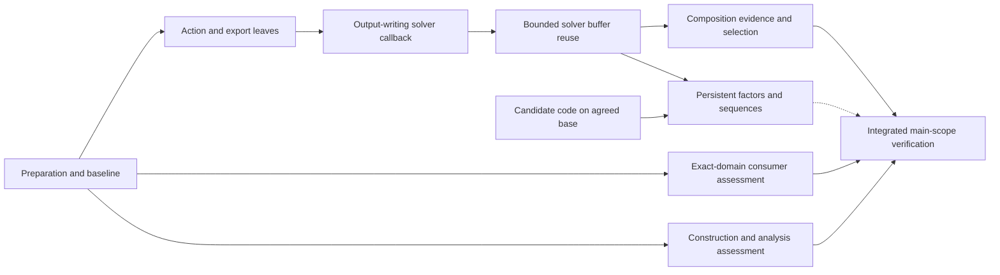

# Staged computation-resource refactor plan

[Design index](README.md) / [Target architecture](overview.md)

Status on 2026-11-25: design and main-based preparation are available for review;
implementation phases have not started. This is a dependency and acceptance
plan, not an estimate of calendar duration or a claim that proposed optimizations
will pass performance gates.

## Reference base and contribution scope

The fixed implemented baseline is
`a3c3e1132800624743ad0f159c9303090e0b3b3f`. Start each implementation contribution
from the current agreed main-based revision and record that actual baseline;
the reference SHA does not authorize relabeling measurements after a rebase.
Keep the documentation proposal separate from kernel implementation changes.

PR 160 was open at `21bd4d9c1fbda28bf0c8107cd663a0e5e17cf851` when this plan was
prepared. Its sparse persistent action, factor and sequence capabilities are a
conditional R4 dependency, not part of the implemented main baseline. Preserve
that contribution's existing ancestry rather than duplicating its feature stack.

Use focused feature branches and the repository's existing contribution and
verification rules. Preserve unrelated work and keep generated evidence outside
Git. Branch names, local setup and authentication details are not architecture
contracts.

## Dependency graph and milestones

R4's dotted integration edge is conditional; it does not block main-based work.
The first milestone is an admitted numerical resource boundary, ordinary-path
integration, explicit domain assessments and verified main-scope changes.
Persistent candidate integration is a second milestone when its base dependency
is available. A completion claim must name which milestone and domains it covers.

| Phase | Current status | Depends on | Reviewable outcome |
| --- | --- | --- | --- |
| R0 | Design/base preparation available | None | This design package and a reproducible main-based implementation baseline |
| R1 | Ready to begin | R0 | Hodge/Dirac output-writing leaves and ordinary export/action integration |
| R2a | Planned | R1 | Shared output-writing callback and every current caller updated |
| R2b | Planned | R2a | Bounded active solver buffers with equivalent numerical method |
| R3 | Planned | R2b | Identified combinations, complete evidence and eligible default decisions |
| R4 | Waiting for candidate base | R2b and agreed availability of PR 160 code | Narrow upper-factor ownership, current-pair action and bounded sequence reuse |
| R5 | Planned domain assessment | R0 and resource-contract review | Concrete exact consumer with an admitted small change or explicit no adoption |
| R6 | Planned domain assessment | R0 and resource-contract review | Justified source/consumer change or explicit no adoption for failed candidates |
| R7 | Planned | Admitted main-scope phases; R4 only if included | Exact-head correctness/project checks, measured reports and updated implemented docs |

## R0: reproducible preparation

R0 fixes the agreed source baseline, reads the affected call/resource boundaries,
records the operation/output/error contracts, and establishes a clean feature
checkout without disturbing unrelated work. The eight topic designs specify the
initial contracts; the existing source and documented guarantees remain the
implementation authority.

Run baseline compilation and the applicable owning checks before implementation,
and preserve independently expected fixtures and the actual source/harness
identities. A baseline compile alone establishes neither MSRV/test/oracle
agreement nor a performance winner. Raw profiles and run manifests stay under
ignored `target/` or approved artifact storage.

Exit: the reference and actual implementation base are unambiguous, documentation
links/source references pass, the selected phase has a concrete caller and
validation plan, and unrelated work remains intact. Complete mathematical and
resource evidence is required again for the actual changed head.

## R1: action and export resource boundaries

Owning design: [05, R1](05-numerical-path.md#r1-output-writing-leaves-in-existing-owners).

1. R1.1 freezes ordinary action/export fixtures and the baseline SHA, inventories
   actual hot allocations/copies and captures existing correctness/error behavior.
   Establish independent signed-chain expectations before changing a leaf.
2. R1.2 adds the private Hodge output-writing contract with caller-owned lower
   temporary, preserving full/lower/upper selection and arithmetic order.
3. R1.3 makes the ordinary Hodge matrix path reuse action work vectors across
   columns while retaining its dense output caps, basis/order and owned matrix.
4. R1.4 adds the private full Dirac output-writing leaf and routes ordinary
   allocation-returning action through it. Keep its direct dense-entry export.
5. R1.5 verifies shape, nonfinite, limit/cancellation, dirty reuse and earlier live
   outputs; compares ordinary complete action/export lifetimes against baseline.

Code scope: `src/hodge/mod.rs`, `src/dirac/mod.rs` and their actual tests. Update
affected rustdoc/guide statements only when behavior/cost documentation changes.
No public workspace, new crate, new mathematical method or generalized operator
trait belongs in this phase.

Exit: existing terminals use the leaves, all applicable correctness/resource
checks pass, per-column temporary allocation is removed where claimed, and the
ordinary small/cold/large export comparison clears its preregistered gate. Keep
separate evidence for internal mechanism and end-to-end benefit. If a leaf adds
uncompensated overhead, revise/reject that boundary before expanding it.

## R2a: output-writing iterative callback

Owning design: [05, R2a](05-numerical-path.md#r2a-change-the-shared-action-callback).

Update `src/eigensolver.rs`, `src/hodge/spectrum.rs`,
`src/dirac/spectrum.rs` and colocated callbacks/tests together. The solver supplies
output slices; Hodge and Dirac Gram callers capture their own narrow temporary
storage. Do not leave an allocating bridge on the ordinary path.

Exit: all callers compile, action/residual/sign/lift behavior and count-zero/error
contracts agree, and ordinary partial/boundary terminals actually exercise the
new callback. No solver formula, rank threshold, seed, stopping condition,
sorting or preconditioner change is combined with this interface migration.

## R2b: bounded solver storage

Owning design: [05, R2b](05-numerical-path.md#r2b-reuse-live-solver-blocks-without-changing-the-method).

Inventory each live block and last use before reusing it. Preserve active-prefix
semantics, basis/image overlap, old-vector lifetime, Ritz work and fresh final
action verification. Retain inner capacities, not just outer vector lists.
Keep checked per-buffer caps and fallible growth; compare lazy active reservation
with any proposed maximum reservation instead of silently retaining all maxima.

Exit: fixed-shape scratch growth after sufficient reservation no longer scales
with iteration count; numerical/reference/failure checks pass; ordinary partial
solves pass the complete setup/solve/verification/output/drop gate on tiny,
early-converged, repeated-root and difficult controls. Result vectors remain
owned and original-coordinate residuals remain fresh.

R2a and R2b are separate review units so a failed storage layout does not require
reverting an independently useful callback boundary.

## R3: domain composition, evidence and default decisions

Owning designs: [03](03-plans-and-selection.md) and
[08](08-verification-and-admission.md).

Record the real changed choices and combinations, including resource ownership,
eligibility, single-choice/coupled evidence and adoption state. Add reproducible
route/reason diagnostics to existing benchmark tooling as needed. The library
does not load reports at runtime.

Use existing owner branches/options where sufficient. Introduce a closed private
plan only where multiple real choices need to persist through composition.
The phase does not exist to install a mandatory `Plan` struct. Any new automatic
selector must have a cheap prospective predicate and same-contract fallback, with
tests on either side and full selection/conversion cost included.

Exit: the admitted internal kernel is reached through normal terminals, the
actual selected route is observable in evidence, important interactions have
been tested, and every default decision has a source-bound reason. Dense full
requests are not silently changed to partial candidates. A failed selector keeps
the prior valid default even if its explicit algorithm remains useful.

## R4: candidate persistent actions, factors and sequences

Owning designs: [04](04-preparation-and-sequences.md) and
[05, R4](05-numerical-path.md#r4-persistent-action-and-factors-candidate-dependency).

Prerequisite: the candidate capabilities are on the agreed implementation base,
normally after their upstream integration. A separately agreed dependent
integration branch must preserve PR 160 and its original ancestor history, with
the dependency explicit; avoid duplicate feature stacks. This dependency does
not block R1-R3/R5/R6.

First migrate action/projection output/scratch under the same fixed numerical
contract. Then separate reusable upper content from current lower/context state;
replace construction-and-clearing/copying of complete operators only where a
narrow borrow/move is valid and beneficial. Finally adapt relevant-pair and
fixed-endpoint drivers to bounded retention and mapped warm vectors.

Exit: current lower terms, pair order/duplicates, source metadata, compact/rank
policy, range lifting and fresh residuals agree; cumulative factor/output limits
and failed updates are correct. Compare cache/warm choices and their interactions,
including complete setup and the known slower small batches/increased peak case.
No general faster-default or memory-win claim follows from functional reuse.

## R5: exact-domain consumer assessment and bounded implementation

Owning design: [06](06-exact-algebra.md).

Select a real serial F2 repeated/multi-output consumer and profile its actual
preparation/query work. Check whether it can move/borrow existing compatible
content or just improve query-local scratch. Preserve complete input/order,
transform requirements, serial support form and F2 run bindings. Keep specialized
PH and separate F2 RREF independent.

Implement only the justified owner-local boundary, with exact equation/support
and required independent topology checks. Compare pair-only, transform-retaining,
cold, lazy and warm lifetimes as applicable. Do not unify matrix representations
or import clearing/parallel forms to obtain sharing.

Exit: an admitted concrete change consumed on a real path, or a documented
no-adoption decision identifying the tested consumer/boundary and evidence.
An unused generic reduction carrier is not an acceptable output.

## R6: construction and analysis consumer assessment

Owning design: [07](07-construction-and-consumers.md).

Review the source/consumer boundaries for a measured duplicate scan, copy,
preparation or materialization cost. Keep direct/prepared/explicit distinctions,
callback effects, construction guarantees and output ownership. Evaluate
descriptor events or repeated matching only for a named reuse workload.

The B3/B5 pool/preparation evidence remains an admission constraint. A new
candidate must compare ordinary scope build/query/drop, repeated versus distinct
operands, small/mixed inputs and retained outputs. Do not revive rejected public
Workspace/Batch designs through an architecture rename.

Exit: a small admitted change in its existing owner and ordinary path, or an
explicit no-adoption record for candidates without sufficient benefit. Scalar
and constant-space operations do not need a workspace migration.

## R7: verify the actual integrated scope

Run applicable project/full checks for every code change as it is made; R7 is not
permission to postpone them. At a milestone boundary, verify the actual composed
head and rerun only measurements/checks whose inputs or claims changed. Keep
baseline/candidate/harness identities and failed attempts separate.

Update implemented architecture and affected owner guides/rustdoc/examples with
actual new contracts, plus changelog/migration only for a real compatibility
change. Remove temporary allocating bridges, dead alternatives and unused
abstractions. Keep research-only choices labeled and generated evidence outside Git.

Exit: integrated correctness/resource/reference checks and required exact-head
CI pass; the ordinary paths demonstrably use admitted code; reports bind actual
measured revisions; retained negative cases and remaining exclusions are clear.
Publishing, merging and release remain separate operations. No phase is complete
merely because its branch exists or a design has been written.

## Review units, rollback and next action

Keep leaf contracts, callback migration, buffer layout and selector/admission
changes in separate buildable review units. Cut focused feature branches from
actual phase boundaries if needed; this plan does not require one giant PR.
Submissions follow CONTRIBUTING and the existing PR template. A merged design
proposal is not an implemented kernel or an adopted automatic route.

If a phase fails, preserve raw evidence and retain/reinstate the simpler
owner-local route. Revert shared phase changes in dependency order when needed;
do not reset or clean another contributor's work. Later layers cannot declare a
rejected optimization adopted merely by composing it with others.

The first implementation task is **R1.1**: freeze ordinary Hodge action/export
fixtures and allocation/copy observations, verify independent expected behavior,
then implement the smallest output-writing leaf. Detailed contracts are in 02
and 05; evidence requirements are in 08.
