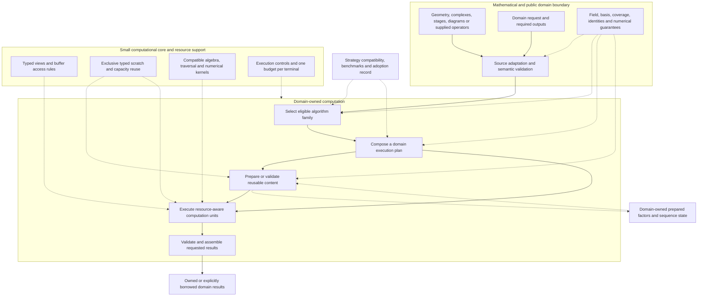
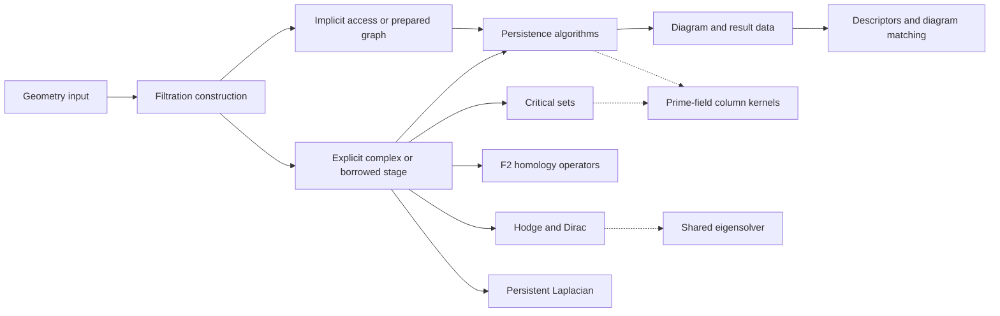
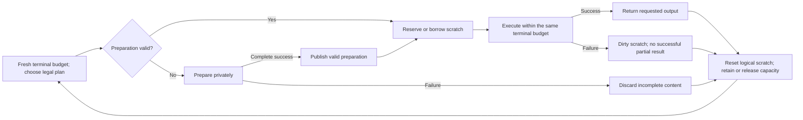
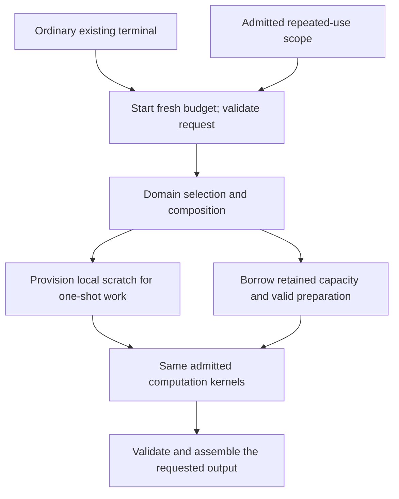

# Computation and resource architecture: target design

[Design index](README.md) / [Documentation](../../README.md)

Status on 2026-11-25: a source-grounded target architecture proposal for review.
The investigation below describes fixed revisions; the target design is proposed,
not implemented or an approved public API. This documentation does not change
production code, default routing or existing algorithm contributions.

The question is how Cocycle should organize executable work, storage lifetimes,
preparation and optimization across its existing mathematical domains. Describing
more mathematical objects, adding a configuration struct named `Plan`, or sharing
an allocator alone does not answer that question.

The design makes **resource-aware computation units** the first-class execution
concept. Mathematical contracts determine what is legal; domain-owned plans
compose executable work; typed storage and explicitly owned preparation make
reuse possible. This adds a computational boundary to the existing
source/algorithm/result architecture and requires substantive changes in selected
internal interfaces. It does not require replacing the mathematical domains.

Read [the target architecture](#22-final-target-architecture) for responsibilities,
[the seven answers](#7-direct-answers-to-the-seven-architecture-questions) for the
decisions, [worked plans](#8-worked-plans-mathematics-lowered-to-computation) for
concrete behavior, and [migration and acceptance](#9-target-state-bounded-migration-and-acceptance)
for the state an implementation must reach. Sections 3-6 preserve the source map
and negative evidence behind those choices.

The [implementation design package](README.md) expands each boundary into a
small topic document and a staged development plan. Those documents own the
implementation contracts and phase dependencies; this page owns the overall
architecture, current source map and seven design decisions.

## 1. Evidence scope and version boundaries

| Scope | Fixed identity | Interpretation |
| --- | --- | --- |
| Main | `a3c3e1132800624743ad0f159c9303090e0b3b3f` | Primary implemented baseline; includes Unreleased capabilities, not a release claim |
| Spectral integration, PR 160 | `21bd4d9c1fbda28bf0c8107cd663a0e5e17cf851` | Candidate-only production additions and research tooling; open when this proposal was prepared |
| Scoped distance preparation study | `7b9c2ab75d353b4b3737439e1c19149974716874` | Research evidence; no production `src/` delta from its baseline |

The source map covers all fourteen public domains and the private numerical
solver, with focused traces through entry points, preparation, repeated work,
resource ownership and result boundaries. It is a map of important call/data
relationships, not a claim that every line was reviewed or every test rerun.
PR 160 composes the work of PRs 151-159; these are not counted as additional
implementations on main.

Evidence labels used below:

- **Observed:** read directly from a fixed source revision.
- **Reported:** an existing study's scoped result, not remeasured here.
- **Proposed:** a design or experiment to evaluate.
- **Unresolved:** evidence needed before selecting an implementation or policy.

Fixed Git source/report links below identify the owning evidence. No new
allocation profile, benchmark campaign, external-oracle run or algorithm test
result is claimed for this documentation proposal. Implemented source, historical
reports and target responsibilities retain separate status; dated pending-PR
prose is not authority over actual exports at the reference revision.

## 2. What the library serves, and what the execution architecture should serve

The implemented product is a native Rust TDA library. Its mathematical requests
include construction, persistence, representatives, descriptors, diagram matching,
real operators/spectra and exact F2 operator queries. Several consumers operate
without a filtration, PH computation or persistence diagram. Those routes remain
legitimate; a new execution layer must not force them through an unrelated domain.

The proposed execution architecture serves **workloads made of these computations**:
single requests, iterative kernels, repeated queries, finite sequences and
multi-output consumption. Its objective is to reduce avoidable allocation,
copying, traversal, preparation and recomputation while retaining the requested
mathematical and failure contracts. Fewer allocations are one possible mechanism,
not the complete objective or proof of a speedup.

The first-class execution concept is a **computation unit with an explicit
resource contract**: executable work whose caller can reason about data access,
output placement, temporary capacity, preparation dependencies and failure.
Examples are incidence application, projection, column reduction, operand
preparation and a solver's bounded iteration scope. A matrix is data; a
Laplacian is a mathematical operation; a prepared factor is retained content.
None of those alone describes the execution and storage effects of applying it.

### 2.1 Mathematical abstractions and computation units have different jobs

| Responsibility | Question it answers | Examples | What it does not decide |
| --- | --- | --- | --- |
| Mathematical model and request | Which object, operation and guarantees are required? | Field, degree, ordered chain basis, filtration coverage, diagram versus representatives, real partial versus full spectrum | Buffer ownership, temporary allocation, storage placement or scheduling |
| Domain execution plan | Which legal implementation steps will satisfy this request in this workload? | Specialized H1 or cohomology, retain transforms or not, sparse action plus a partial solver, prepare once or recompute | New mathematical guarantees or validity of arbitrary cached content |
| Computation unit | What work executes, and what resources/effects does it require? | Apply incidence into an output, reduce one working column, prepare a projector, form a Ritz block | Global default policy or ownership of every domain object |
| Storage and prepared-state ownership | Where are bytes and useful retained content held, for how long, and when are they valid? | Borrowed slices, typed scratch vectors, immutable factors, sequence state, owned outputs | Choice of field, pairing rule or spectrum target |

For example, the real Hodge operation is
`L_q x = B_q^T (B_q x) + B_(q+1) (B_(q+1)^T x)` in its declared ordered basis
with the Euclidean inner product. That meaning does not require a dense matrix.
A computational implementation may traverse sparse incidence, retain the lower intermediate in
scratch, accumulate the upper term directly and write into caller-supplied output.
Another implementation may multiply a materialized dense matrix. The requested
operator is the same; preparation, live storage and work are different.

Conversely, one signed-incidence application or symmetric eigensolver can serve
several mathematical domains when its actual arithmetic, basis and numerical
contracts agree. An F2 RREF and a real orthogonal projection do not become the
same computation because both use matrices. The relation between mathematical
operations and computation units is many-to-many.

This separation is a responsibility boundary. Mathematical types continue to
carry their existing meaning and identity. Computation units are ordinarily
functions and local loops, not a runtime object for each scalar operation. An
explicit plan can be a few branches, local variables or a closed private enum
where multiple real implementations exist. These concepts do not require a new
public type for each row of the table.

### 2.2 Final target architecture

This is the proposed final responsibility map. Section 3 separately draws the
implemented data flow. Solid arrows below denote calls or data flow; dotted
arrows denote constraints, supplied resources or development-time evidence.



The small core is the useful part of the microkernel analogy: reusable
computational facilities and explicit resource rules support domain algorithms.
Domain knowledge stays in domain owners. There is no central component that
understands every filtration, selects every algorithm or stores every factor.
The core can live in existing modules; the boxes are responsibilities, not new
crates, a plugin protocol or a requirement for virtual calls.

The plan resolves legality, implementation, retention and step lifetimes. The
resource owner supplies storage satisfying that plan; it does not choose the
mathematical answer. Prepared content remains with its narrow domain owner.
Existing H1/cohomology, matching and F2 algorithms keep their private working
representations. Small scalar operations can inline selection and call a kernel
directly with zero scratch; the drawing imposes no per-call plan allocation.

### 2.3 What makes a computation unit first-class

The caller must be able to answer the following questions at a useful
composition boundary. Ordinary Rust signatures, private types, rustdoc and tests
can express the answers; a common trait is not required.

| Contract element | Required information |
| --- | --- |
| Meaning and eligibility | Operation, supported arithmetic/domain, shape, basis/layout and required preparation |
| Reads and writes | Borrowed immutable inputs, mutable outputs, full overwrite versus accumulation, permitted aliasing |
| Storage needs | Known or bounded typed scratch, checked sizing, or explicitly data-dependent fallible growth |
| Retention | Which intermediate must survive; which buffers can be reset, moved or reused after last use |
| Reusable content | Dependencies of structure, numeric factors and warm-start coordinates; invalidation/update rule |
| Effects and failure | Callback effects/order, cumulative budget/cancellation behavior, dirty scratch and output-on-error behavior |

The organizing object is therefore executable work, with strategies and
preparation describing its implementation and lifetime. Merely naming request
capabilities, mathematical operators or prepared state as first-class leaves
temporary allocation and composition hidden. Merely adding a shared allocator
leaves repeated traversal, copying and unnecessary materialization untouched.

## 3. Implemented module and resource ownership

Main exports fourteen public domains and a private numerical solver. The source
tree follows mathematical responsibilities inside one crate. The current Cargo
contract is Rust 1.91, safe Rust, and no runtime dependencies. [Exports][m-lib]
and [manifest][m-cargo] are authoritative over stale prose.

| Owner | Actual consumers / callees | Principal storage and lifetime |
| --- | --- | --- |
| `geometry` | Construction and PH adapters consume borrowed point/matrix views; pair evaluation serves dense and streamed construction | Validated views borrow caller storage; dense Euclidean conversion creates an owned condensed buffer |
| `complex` | Filtration construction, generic PH, critical sets and operator domains consume its topology/access | Graphs own edges plus compact adjacency; simplicial storage owns vertices, lookup and signed incidence in both directions |
| `filtration` | Source adapters consume prepared graphs, implicit access or explicit topology; stage-pair consumers read borrowed stages | `prepare()` owns reusable source data; explicit expansion owns potentially exponential topology; stages borrow source prefixes |
| `persistence` | Source adapters call H0/H1, generic cohomology or boundary reduction, then assemble diagram/representative outputs | Algorithm-local pivots, heaps, levels and transforms; retained state depends on requested output |
| `algebra` | Boundary PH, representatives and critical sets use prime-field columns/reduction | `Column` uses `BTreeMap`; boundary reduction consumes columns and optionally retains transforms |
| `diagram` | Descriptors and matching consume logical diagram data/common context | Owned result data; `AsRef` borrows and `into_parts` moves; physical interval layout is not a public contract |
| `descriptors` | Reads diagrams directly, never reruns PH | Lifetime summary has O(1) auxiliary storage; Betti curve builds/sorts events and owns grid output |
| `diagram_distances` | Public/context-aware facades call private matching owners | Each call extracts operand points, then creates pair-local graph, matching and solver state; existing adaptive choices remain local |
| `optimization` | Explicit critical-set requests on an immutable supplied complex | Borrowed source; retained primal R/V; lazy dual and per-dimension transposes; bounded U rows are queried rather than retained |
| `homology_operators` | Exact F2 windows support projections, class/filling queries and finite families | Adaptive sparse/packed matrices; factorized or explicit action; `Arc`-shared context/run bindings; request-local RREF and query output |
| `hodge` | Signed supplied chains/stages feed action, matrix and spectrum requests | Owned adjacent incidence and ordered bases; repeated action currently returns freshly allocated vectors |
| `dirac` | Signed chains/stages feed graded action/export and boundary modes | Owned signed incidence/offsets; action owns output; boundary spectral work calls shared LOBPCG |
| `persistent_laplacian` | Same-source stage pairs feed dense operators, spectra and fixed-endpoint elimination | Main owns dense Schur matrices; sequence calls reuse a target upper matrix and retain each requested output |
| `execution` | Construction, matching and algebra/operator terminals pass private budgets through composition | `Execution` is immutable configuration; `WorkBudget` counts one operation; neither owns scratch nor imposes an RSS quota |
| Private `eigensolver` | Hodge/Dirac use LOBPCG and small Ritz/Jacobi work | Local iterative blocks, images and projected matrices; main persistent Schur has its own numerical policy/core |
| Shared `error` | All owners report structured input, resource and numerical errors | No workspace, dispatch or partial-result owner |

Representative source evidence: [views][m-point], [graph adjacency][m-adjacency],
[simplicial storage][m-complex], [construction][m-rips-builder],
[boundary reduction][m-reduce], [result ownership][m-result],
[distance facade][m-distance], [critical sets][m-critical],
[F2 arithmetic][m-f2], [execution controls][m-execution].

This is not a strict module dependency DAG. For example, `complex.stage()` returns
`filtration::SimplicialStage`, and that stage implements `FilteredComplex` in the
complex owner. The important computation direction is that construction does not
invoke PH, algorithms do not call back into default PH dispatch, and diagram
consumers do not need the producer's internal workspace.

The solid arrows below show principal data consumption; dotted arrows show
selected shared-kernel calls. Supplied complexes and diagrams can enter at their
own nodes. Execution controls and errors serve multiple paths and are omitted
from this drawing. It is not a compiler import graph or a mandatory pipeline.



On main, the persistent Schur solver is separate from `E`. Candidate PR 160
additionally connects persistent partial-spectrum work to that shared solver.

## 4. Verified call paths and their resource boundaries

### 4.1 Input validation and exact/approximate construction

`PointCloudView::new` validates and borrows coordinates. Matrix views similarly
borrow existing layouts. A borrow avoids an input copy; it does not make later
construction or analysis allocation-free. [Point access][m-point], [matrix access][m-matrix]

For exact construction, `RipsBuilder::prepare_with` passes one budget to
`prepare_budget` and `exact::build_with`. Every pair is inspected, but only
accepted edges are retained; `WeightedGraph` builds sorted adjacency. A finite
cutoff avoids retaining a dense distance matrix, not the exhaustive pair work.
Explicit expansion subsequently generates simplex levels and constructs owned
lookup/incidence. [Builder][m-rips-builder], [exact graph][m-exact], [expansion][m-expansion]

The direct PH point adapter has a distinct resource choice: a finite effective
cap prepares a threshold graph; unrestricted input constructs a condensed distance
buffer. A prepared source preserves its construction range for reuse, whereas a
single direct request may retain only the edges it needs. That existing distinction
is an example to preserve, not replace with mandatory preparation of everything.
[Direct adapter][m-rips-compute]

Approximation has different legality and effects. Sampling, modified edges,
insertion radii, original labels, metric assumptions and blockers belong to that
construction. A stateful callback builder is consumed; its preparation caches
each unordered pair once before subsequent sampling/access. An optimizer must
not replay, duplicate or reorder arbitrary callbacks as if they were pure reads.
[Approximate callback preparation][m-approx-builder]

### 4.2 PH requests, specialized dispatch and output-dependent state

```text
source.persistence()
  -> PersistenceBuilder::compute_with
  -> the source-specific function bound in persistence/source.rs
  -> preparation/range interpretation in the source adapter
  -> algorithm
  -> diagram assembly and source context
  -> owned PersistenceResult
```

The source wiring binds functions; it does not perform the mathematical work.
The builder supplies one budget for its terminal. [Source wiring][m-source],
[builder terminal][m-builder]

Exact flag dispatch chooses H0 union-find, specialized F2 H1, specialized H0/H1
followed by H2+ continuation, or generic cohomology as permitted by dimension,
field and index availability. H1-only execution omits continuation-key collection.
Odd-prime and overflow fallbacks preserve their domain. [Dispatch][m-dispatch]

Concrete simplicial requests use construction guarantees. Compatible zero-born
diagram-only requests use stored coface access; general requests use selected
boundary columns. External `FilteredComplex` input goes through traversal,
selected-boundary and selected-field chain validation. Representative requests
retain transformations and may materialize an implicit skeleton. Those preparation
and validation costs must not be erased from a comparison. [Concrete routing][m-simplicial],
[external reader][m-filtered], [representatives][m-representatives]

`reduce_pairs` avoids retained transforms through a const-generic branch; `reduce`
retains them. These are already output-driven resource decisions. The generic
cohomology path reconstructs working coboundaries from transformations, trading
storage for traversal rather than retaining every reduced column. H1 clears
working heaps between columns and recovers heap backing storage for initialization.
[Reducer][m-reduce], [generic cohomology][m-cohomology], [H1 reuse][m-h1-reuse]

These paths cannot be forced through one representation merely to obtain a common
workspace. A prior uniform-boundary routing experiment was withdrawn after its
low-degree workflow gate failed. [Integration outcome][r-critical]

### 4.3 Critical sets and exact F2 operators are different consumers

`CriticalSetWorkspace::new_with` builds serial F2 primal R/V from the whole
supplied complex. A query creates a fresh budget, prepares dual state only when
needed, and commits a complete dimension transpose after successful preparation.
Bounded U solves create query-local residual/result columns. [Workspace and invariants][m-critical]

Matching source, field and dimensions alone does not authorize importing any
decomposition: the critical-set formulas require the serial ELZ/lazy support
property. Cleared or parallel decompositions are explicitly excluded. A future
shared reduction object must describe the form and guarantees actually retained,
not just claim to contain R and V.

`ChainWindow::from_complex` instead converts a signed window to exact F2 matrices.
`HomologyOperator::feasible` prepares generalized inverses and validates its
factorized projection. Its private RREF is not PH column reduction, and does not
preserve the same filtration-pivot semantics. `ClassQuery` shares immutable window
and run identity through `Arc`. [Projection owner][m-homology], [RREF][m-f2-prepare]

`OperatorFamily::barcode_with` already keeps only two temporary homology bases
during preparation, retains adjacent homology-coordinate maps, and reduces their
compositions for a finite rank invariant. Feature histories are intentional owned
outputs. Exact affine minimization and stretch can remain exponential; buffer
reuse does not remove that mathematical work. [Family lifecycle][m-family],
[query/search scope][m-homology]

### 4.4 Results, descriptors and matching

`PersistenceData` owns diagram/context without engine state. `AsRef` borrows it;
`into_parts` moves common data and witnesses; explicit cloning copies owned data.
The public diagram contract offers logical values, not a stable physical slice
layout suitable for arbitrary zero-copy matching. [Common data][m-data],
[moves][m-result], [diagram contract][m-diagram]

Lifetime summary scans an existing diagram using constant auxiliary storage.
Betti curves allocate and sort birth/death events, then scan the requested grid.
Repeated-grid preparation is a possible separate hypothesis; it has not been
shown to justify new state or a public API. [Summary][m-summary], [curve][m-betti]

Distance facades validate dimension/coverage/context and allocate finite and
essential operand arrays. Kernels then perform pair-specific preparation and
matching. Wasserstein already chooses dense/sparse storage and solving, certified
greedy attempts, duplicate-capacity flows, component solves and a numerical
direct-cost route. Pair scaling means not all normalized data are operand-local.
Bottleneck also retains its private specialized routes. [Facade][m-distance],
[Wasserstein selection][m-wasserstein], [graph storage][m-distance-graph],
[bottleneck][m-bottleneck]

### 4.5 Real numerical paths on main

`HodgeLaplacian::new_with` snapshots adjacent signed incidence from a supplied
chain/stage and checks the retained integer chain condition. Its action allocates
output and, for the lower term, an intermediate vector. Dense matrix export
repeatedly invokes that action. `smallest_eigenpairs` passes sparse action to
shared LOBPCG; `spectrum` materializes and solves a dense problem. A selected
dense eigenpair range still pays the complete dense solve. [Hodge action][m-hodge],
[spectral terminals][m-hodge-spectrum]

`DiracOperator` owns selected signed incidence and degree offsets. Its action
allocates output. `boundary_spectrum` supplies B-transpose-B action to shared
LOBPCG, lifts singular modes, and verifies signed pairs against the actual
truncated Dirac operator. It does not request PH. [Dirac][m-dirac], [boundary modes][m-dirac-spectrum]

Main's `PersistentLaplacian::compute` builds an upper Gram, performs generalized
Schur elimination and adds the current lower term. It owns a dense matrix;
`action` multiplies that matrix and `spectrum` calls the private Schur eigensystem.
Fixed-endpoint batches build the target upper matrix once and eliminate in reverse
order, with a documented direct fallback for coupled near-zero pivots. Each result
still owns its requested matrix. [Persistent main implementation][m-persistent]

Shared LOBPCG currently builds new search-basis/image blocks and projected matrices
within iteration. A common solver function is therefore not yet a common caller-
supplied scratch contract. Main persistent Schur and shared Ritz Jacobi have
different policies; consolidating their formulas is a separate numerical change.
[Main iterative implementation][m-eigensolver]

### 4.6 Candidate-only integration and other open work

PR 160 adds fixed sparse persistent action, explicit compact non-branching
projection, partial targets, positive-range preparation, reverse updates and
relevant-pair upper-factor reuse. It also includes bounded Gram/restriction and
ordinary HeCS interfaces. These are multiple routes, not one combination that
automatically enables every technique. [Candidate operator][c-operator],
[batch reuse][c-relevant], [HeCS][c-hecs], [Gram/restriction][c-split]

The candidate's persistent `action_with` creates upper scratch, output and lower
scratch; row-space projection creates a coefficient vector. Positive-range
iteration adds lifting/restriction buffers. `reuse_upper` constructs a current
operator and copies cached factors into it; relevant-pair scheduling stores whole
operators as the cache carrier. These are concrete allocation/copy inspection
points, not measured explanations for the reported batch regressions.
[Action][c-action], [upper reuse][c-upper-reuse]

Adaptive LSMR is a separately exposed diagnostic. It does not certify a fixed
linear self-adjoint projector and must not be substituted into an eigensolver's
fixed action on naming similarity alone. Ordinary q=1 HeCS also has explicit
simplicial/weight/image conditions and is not a persistent preconditioner by
default. [LSMR contract][c-lsmr], [HeCS contract][c-hecs]

The open-PR inventory was also checked beyond this spectral stack:

| Work | Actual location / status | Consequence for this document |
| --- | --- | --- |
| PR 56, `0a137833...` | Adaptive F2 H1 access/bitsets/ordered cursors; draft/no-go | Existing local policy experiments, not an admitted main route |
| PR 136, `e8ec41b6...` | Operator/research route docs, examples, tests and checks; no authored `src/` delta | Handoffs and consumers, not a new execution namespace |
| PR 137, `ff948384...` | External-learning handoff checks/reference runner; no authored `src/` delta | Application/tooling boundary must remain explicit |
| PR 138, `bfcad5de...` | Real Rust spectral-feature reference tooling; no authored `src/` delta | Feature workload evidence, not a general library learning engine |
| PR 139, `632a1728...` | Hausdorff in `geometry/distance.rs`, with execution/docs/examples | Candidate borrowed point-set comparisons; O(1) per-comparison scratch, owned sample-matrix output |
| PRs 151-159 | Original research/library work preserved as ancestors of PR 160 | Standalone sampling/subspace reproductions are not automatically default production strategies |

PR 139's direct Hausdorff scans are also a counterexample to mandatory workspace
allocation for every operation: its scalar calculation needs constant auxiliary
space. [Hausdorff candidate][c-hausdorff]

## 5. Existing experiments constrain the target architecture

The project has already researched several ideas discussed in the conversation.
Their outcomes must be carried into a new design rather than rediscovered as
unqualified recommendations.

| Evidence | Established scope | Required design consequence |
| --- | --- | --- |
| Distance lifecycle, B3 / Issue 18 | Compared prepared operands, batch-local/cross-batch scratch pools and retained outputs; rejected promoting tested Workspace/Batch designs | Do not make a public reusable context or pool a project-wide success criterion |
| Scoped preparation, B5 / Issue 31 | Complete build/query/destruction studies found conditional repeated-comparison survivors; no production Prepared API delivered | Preparation reuse needs its own lifetime and amortization evidence; it is distinct from scratch pooling |
| Concurrent resource study, B4 / Issue 19 | No tested deployable routing policy passed its joint holdout/repeat gate | A resource model and hindsight oracle are not evidence for automatic runtime scheduling |
| Critical-set integration | Uniform-boundary and H2+-only rerouting failed a low-degree gate and were withdrawn | Keep specialized PH paths; common resources do not imply one mandatory reducer |
| Adaptive H1, PR 56 | Reported complete-workflow regressions retained; current candidate remains draft/no-go | Include policy evaluation, conversions and handoff costs before accepting a selector |
| Spectral integration, PR 160 | Report retains slower small fixed-endpoint/relevant-pair batches and higher peak in one batch case | Functional reuse is not sufficient evidence for faster defaults or lower aggregate memory |

Sources: [lifecycle decision][r-lifecycle], [scoped preparation][r-scoped],
[B1-B4 disposition][r-baseline], [critical-set outcome][r-critical],
[PR 56 source-bound report][r-h1], [spectral report][r-spectral]. These are reported
results at their recorded measured revisions; none was rerun or relabeled as a
measurement of current main in this investigation.

## 6. Diagnosis: why the optimizations still look fragmented

The existing source/algorithm/result split describes mathematical ownership well.
Optimization work crosses another dimension: how successive computations obtain,
reuse and release resources. That dimension is currently expressed differently
inside each owner. Adding another mathematical module or another complete
candidate route does not establish the missing composition boundary.

**Observed gap: resource visibility is uneven.** Owned-output functions often
also allocate hidden temporary storage. Iterative and composed callers cannot
always supply reusable buffers. H1, critical sets, finite F2 families and
fixed-endpoint elimination already demonstrate useful local lifetime control.
The design should generalize justified contracts, not erase those implementations.

**Design gap: selecting a complete route does not explain its internal choices.**
Existing dispatch correctly chooses legal algorithm families, and reports already
gate adoption. A composed route additionally needs to identify its independently
variable choices, compatibility, retained state, eligible region and evidence.
These can be local code decisions plus a report table. A new global planner or
runtime strategy catalog is not needed to make them explicit.

**Observed gap: a reusable carrier sometimes owns more than the reusable part.**
PR 160's upper-factor cache uses complete persistent operators and copies their
factors into current requests. An explicit upper-factor boundary is a concrete
candidate. Its representation, copying/sharing cost and cumulative retention
must still be compared before adoption.

**Observed boundary: allocation, retained content and logical results differ.**
Free capacity may be reused across unrelated computations with compatible type,
layout and exclusive lifetime. A prepared structure requires its structural
dependencies to match. A numeric/filtered decomposition additionally requires
the correct data, ordering, policy and algebraic form. Warm vectors may be
transferred across changing operators only through valid coordinate mapping and
fresh current-operator evaluation; they are not cached current eigenpairs.

**Observed boundary: output and identity ownership are deliberate.** Borrowed
critical workspaces, owned real snapshots, `Arc`-bound F2 query windows and owned
diagram witnesses solve different lifetime problems. Resource reuse must not
invalidate live outputs, erase run bindings or turn source-local IDs into global
identities. A generic content hash is not a free or sufficient replacement.

**Unresolved: actual dominant costs.** Allocation sites and copies are visible in
source, but their latency fraction, allocator behavior, cache effects and peak
live memory have not been measured here. The existing negative studies make it
especially important not to label every `Vec::new` or clone a performance defect.

## 7. Direct answers to the seven architecture questions

### 7.1 What is first-class, and how is an optimization represented?

**Decision: resource-aware executable computation is first-class.** The
[unit contract](#23-what-makes-a-computation-unit-first-class) makes work
composable. A domain execution plan is its composition; a strategy is an
implementation choice; prepared state is reusable content; scratch is storage.
These roles must remain distinguishable even when one private type owns several.

An optimization is a legal change to how those computations execute or retain
resources: replace a representation/kernel, omit an unrequested transform,
reuse capacity, reuse valid preparation, fuse traversals, avoid a copy, change
materialization placement, or use a justified incremental update. It is not a
mathematical object or necessarily a plugin object. Its success is lower measured
work/cost under the same requested guarantees, not just fewer allocations.

Each real alternative should have a small record beside its owner/report:

```text
operation and output contract
changed strategy axis and baseline
eligibility and required preparation
compatible / incompatible choices
scratch, retained content and invalidation
independent correctness and full-workload evidence
adoption state, selector rule and fallback
```

This record belongs in documentation and benchmark metadata; it is not a
mandatory runtime allocation. It supplies the missing connection from an
optimization experiment to executable code and default selection.

### 7.2 How do optimizations compose?

**Decision: compose legal computations through both dependencies and resource
lifetimes, then verify the combined cost.** Independent strategy axes are useful
only inside the implementation family that actually supports them. Calling them
axes does not make their Cartesian product legal.

| Domain scope | Choices worth identifying | Constraints on independence |
| --- | --- | --- |
| PH | Input access, selected reducer/cohomology family, column representation, retained pairs/transforms | Specialized H1, implicit cohomology and boundary reduction are distinct algorithms; clearing and witnesses have different requirements |
| Exact F2 queries | Sparse/packed storage, factorized/explicit action, retained query preparation | Private RREF does not acquire PH pivot or serial support semantics |
| Real spectra | Dense versus fixed sparse action, permitted restriction, full versus partial solve, factor reuse, warm vectors | Target, rank policy, self-adjointness, coordinate maps and residual checks couple some choices |
| Diagram matching | Operand preparation, pair-local normalization, solver/storage choice, repeated scope | Pair-dependent scale and graph structure cannot be assumed operand-local |

These are a vocabulary for actual choices, not instructions to implement every
alternative or expose every axis publicly. The current implementations remain
authoritative about which combinations exist.

For each candidate composition, check in order: requested output/guarantees,
algorithmic and numerical invariants, preparation dependencies, read/write
lifetimes, and interaction evidence. Examples make those checks concrete:

| Proposed combination | Legality and resource condition |
| --- | --- |
| Fixed sparse self-adjoint action plus partial eigensolver | Same declared space and numerical contract; check current-operator residuals; do not substitute an input-dependent approximate solve for a fixed linear action |
| Positive-range restriction plus sparse projection | Validate the range and lift; it cannot satisfy a full ambient spectrum request by omitting zero modes |
| Serial F2 R/V plus critical-set queries | Same ordered input and required serial ELZ/lazy support form; R/V names alone do not certify compatibility |
| Cleared or parallel reduction plus existing critical formulas | Not eligible under their current support contract |
| Upper-factor reuse plus warm vectors | Validate factors and coordinate mapping separately; recompute current residuals; measure their interaction |
| Scratch sharing between two sequential steps | Compatible typed layout/capacity and no overlapping live use; content from the first step is dead |

For compatible sequential scratch requirements A and B with disjoint lifetimes,
one backing region may satisfy the larger requirement rather than their sum.
Persistent outputs, factors needed by later stages, incompatible element/layout
requirements and concurrent work must be counted separately. Reordering floating
reductions or fusing stages may alter numerical behavior and needs validation.

The required performance evidence includes both single-choice ablations and
interactions: for example sparse/dense action at a matched solve target, cold/warm
vectors with unchanged factors, and factor-cache on/off crossed with warm on/off.
If an isolated axis cannot preserve the same operation, report the coupled
combination rather than assigning a fictional independent speedup.

### 7.3 Who chooses an optimization?

**Decision: selection is domain-owned and layered.** There is no universal
optimizer responsible for every mathematical field and workload.

| Actor | Decision | Concrete placement |
| --- | --- | --- |
| User request | Mathematical output, guarantees and meaningful explicit preferences | Existing builders and domain terminals |
| Source adapter / domain dispatch | Legal algorithm family and source interpretation | Existing PH source wiring and `flag/dispatch.rs`, corresponding operator/matching facade |
| Domain-local selector / composition | Implementation, retention, reuse and materialization within that family | Existing algorithm owner; add a closed private plan only when the choices need one |
| Kernel-local dispatch | Cheap local representation/size/density decisions | Current private matching and sparse/packed kernels |
| Resource owner | Supply, reserve, reset and release storage for the chosen work | Terminal-local scratch or an admitted reusable scope |
| Maintainer admission process | Which eligible choices may be automatic | Pinned correctness/performance reports and the selector's regression cases |

Automatic choice must include selection and conversion cost and have a documented
eligible region. Advanced explicit choices should be reproducible where meaningful.
Apply eligibility in this order: semantic legality, structural/numerical
applicability, declared resource limits, then demonstrated workload benefit.
Evidence is consumed by maintainers when setting the selector; the library does
not load benchmark reports or run a timing competition at each request.

Record the selected route and reason in benchmark/diagnostic tooling so a claimed
optimization can be reproduced. Ordinary calls need no new policy UI. Outside
the admitted region use the existing valid route. A fallback must preserve the
request and account for work already spent; it cannot silently approximate,
replay an effectful callback or restart the terminal budget.

### 7.4 What is shared across algorithms?

**Decision: share resources at their actual compatibility boundary.** Reusing
capacity and reusing computed content have different requirements:

| Reused resource | Necessary compatibility | Example / limit |
| --- | --- | --- |
| Storage capacity | Element type, layout, capacity, initialization and exclusive non-overlapping lifetime | An f64 temporary can serve different operators after reset; equal mathematical identity is unnecessary |
| Structural preparation or execution plan | The structure, layout, options and guarantees that preparation actually depends on | Same sparse pattern can support a structural plan even when values change; no numeric factor is thereby certified |
| Numeric/algebraic content | The data, basis/order, arithmetic, parameters, tolerance policy and retained decomposition form it depends on | Real factors require valid numeric dependencies; critical-set R/V additionally requires serial support form |
| Warm-start vectors | Valid coordinate transfer, dimensions, current solver contract and fresh evaluation | A previous subspace may seed a changed operator; previous eigenvalues/residuals are not current answers |
| Public results and identities | Their own ownership and source/run/context contract | Keep existing owned outputs valid when scratch is reused |

Share stable arithmetic/access primitives and common kernels when their contracts
agree. Keep semantic pairings, current residuals, pivot ownership and mutable
heuristic state with their computation. A domain may explicitly transfer or
retain such state through a documented dependency boundary; it is never an
unqualified project-wide cache entry.

The initial safe-Rust implementation can use typed vectors and borrowed slices.
Cross-type raw-byte reinterpretation, a global arena and exposing node-allocation
internals of every `BTreeMap` are not prerequisites. Existing restrictions on
unsafe code and dependencies remain current constraints.

Two concurrent executions can share immutable preparation if its owner permits
it, but require separate mutable scratch or disjoint borrowed regions. Sharing
the same workspace through a lock would serialize work and must not be treated
as a free memory optimization.

### 7.5 What are the runtime and adoption lifecycles?

**Decision: separate the lifetimes of capacity, valid preparation, sequence state
and outputs, and separately track adoption of an implementation.**

| Runtime resource | Begins | Reuse ends / invalidation | Release owner |
| --- | --- | --- | --- |
| Scratch capacity | Reserve or fallibly grow for selected work | Contents expire after last use; initialize all later reads | Terminal or explicit reuse scope; trim/drop controls retained high water |
| Prepared source, structural plan or factors | Complete successful preparation | Only when one of its recorded dependencies changes; invalidate or perform a validated update | Domain owner or borrowed source scope |
| Sequence state | A declared finite/repeated workload | Source, order/direction, coordinate or numerical assumptions no longer permit reuse | Sequence owner, with explicit bounded retention |
| Requested output | Successful terminal result | Its declared ownership/borrow lifetime; never overwritten by scratch reset | Caller or explicit result owner |

One valid runtime flow is:



The fresh budget starts at the public terminal, before planning/preparation; the
execution box uses that same budget rather than creating another one. Reusable
scopes retain capacity/content, not counters. A source/parameter change is checked
at the next validity test, not inferred from the existence of spare memory.

Errors may leave internal scratch dirty, so the next use must initialize whatever
it reads. Incomplete preparation must not enter a valid cache. Existing owned
public terminals keep no-successful-partial-result behavior; a proposed public
`_into` API would need a separate explicit output-on-error contract. A persistent
workspace must not accidentally accumulate `WorkBudget` across terminals.

Internal `_into` kernels may leave their output unspecified on error if their
caller discards it. In-place updates of retained factors must either commit a
complete valid update or mark that state invalid before any later query. Avoid
copying an entire factor solely for transactional convenience without measuring
the retention/copy cost. `clear` resets logical state; it does not promise memory
release, numerical validity or zero-filled storage.

### 7.6 How does an optimization enter the normal path?

**Decision: integrate admitted improvements into the existing operation owner,
and let normal terminals use the same internal kernels.** A separate experimental
entry point is useful for evidence but does not complete normal-path integration.



The repeated-use branch is introduced only for a justified consumer. Local reuse
inside an ordinary iterative solve does not require a public session API. Existing
small or allocation-free routes remain direct. Both branches preserve the same
mathematical, error and ownership contracts at their public terminal.

The development/adoption lifecycle is explicit and separate from buffer lifetime:

```text
Reference -> Experimental -> Validated opt-in -> Candidate dispatch -> Default
                     \-> Rejected or deferred at any failed gate
```

Reference establishes the operation and independent expectations. Experimental
adds the implementation and explicit failure/resource contract. Validated opt-in
requires independent correctness and useful scoped evidence; it need not be a
performance winner to expose a distinct requested capability. Candidate dispatch
requires a cheap eligible-region predicate, interaction evidence and a valid
fallback. Default requires the owning study's end-to-end, holdout and repeat
gates, including preparation, conversion, selection, retention and destruction.
Retain the slower/small/concurrent cases in regression workloads.

Track this state per strategy **and combination**, with measured source, output,
baseline, applicability, evidence and route identifier. Being merged, explicitly
callable, automatically selected and released are different states. The governance
record informs code review; it is not a runtime registry. Existing rejected
distance Workspace/Batch proposals do not become defaults by adopting the
microkernel analogy.

### 7.7 What is missing from the original architecture?

**Decision: add the missing computation/resource boundary and its adoption loop.**
The original architecture has useful domain ownership, specialized dispatch,
prepared objects, common kernels and benchmark admission. It does not consistently
make the following composition decisions explicit:

| Missing or uneven responsibility | Concrete addition | Where it belongs |
| --- | --- | --- |
| Caller visibility of allocation, writes and temporary lifetime | Resource-aware internal kernels and checked requirements/growth | Selected action, solver, reduction or consumer owner |
| Composition inside a complete algorithm route | Domain-owned implementation/retention/reuse plan, with legal combinations | Between domain request/dispatch and its concrete computation steps |
| Narrow ownership of reusable content | Separate factors/structural preparation from unrelated current-request and scratch state where needed | Existing prepared operator or sequence owner |
| Connection from experimental choice to production use | Compatibility, per-axis/interaction evidence, adoption state and reproducible selector | Reports/tooling plus existing domain dispatch |

This is a substantive internal interface and ownership change. Changing only
documentation, adding a `Plan` options struct, or collecting allocators behind
one context would leave the first row unresolved. Replacing all algorithms with
one reducer would destroy useful existing specializations. The addition is
bounded by concrete repeated work and the negative evidence in section 5.

## 8. Worked plans: mathematics lowered to computation

These are proposed execution arrangements, not new public APIs or performance
claims. They apply the same resource model to different mathematics without
forcing the same algorithm representation.

### 8.1 Real sparse action and repeated spectral work

**Mathematical request:** selected eigenpairs of a declared Hodge/Dirac or
persistent operator, with its requested spectrum target, basis, precision policy
and residual/orthogonality guarantees. Main currently shares Hodge/Dirac iteration;
the persistent sparse/positive/relevant-pair route here is candidate PR 160.

**Proposed execution plan:** prepare the appropriate signed incidence or fixed
projection; choose a valid full/partial/restricted route; reserve bounded solver
blocks and action scratch; iterate using output buffers; lift and validate in
the current original coordinates; assemble only the requested outputs.

The key internal signature can be as small as the following illustrative shape:

```rust,ignore
fn apply_into(
    &self,
    x: &[f64],
    y: &mut [f64],
    scratch: &mut ActionScratch,
    budget: &mut WorkBudget<'_>,
) -> Result<()>;
```

`ActionScratch` is a private owner of typed capacity, not a public algorithm
protocol. Its exact name/type is illustrative. The contract requires compatible
lengths, full initialization of `y` and all scratch entries that will be read,
immutable prepared incidence/factors and no unsupported input/output alias.
The owning public method can still return `Vec<f64>`: allocate its intentional
output, invoke this kernel, and return only on success. A solver instead supplies
one of its existing output blocks. Dense export supplies column work storage and
copies into its intentional dense output without allocating a new action vector
on every column.

| Resource | Required lifetime | Proposed arrangement |
| --- | --- | --- |
| Incidence / fixed upper projection | All actions using that valid operator | Domain-owned immutable preparation, moved/borrowed/shared as justified |
| Lower incidence and pair metadata | Current operator/pair | Separate current-request state; do not retain a complete old operator merely as a factor container |
| Action temporary vectors | One action, capacity usable across actions | Typed reusable scratch; upper projection coefficients and their source vector coexist when required |
| Search basis, images, Ritz data and rotations | Their actual overlapping iteration uses | Solver-owned buffers reserved once for the bounded block size, then reset/rotated; live basis and images cannot alias |
| Warm vectors | Transfer to the next eligible solve | Sequence-owned vectors with explicit basis map; current action/residuals are recomputed |
| Returned modes or dense matrices | Caller lifetime | Owned result storage, separate from reusable scratch |

For the candidate persistent action, preserve the fixed projection's computation
of all coefficients against the original upper temporary. Reusing its storage
must not turn that into a sequentially modified, numerically different projection.
The lower term and upper-factor validity have different dependencies. Check the
actual upper row selection, endpoint/source, basis, values and numerical policy;
sharing an endpoint alone is not a generic factor-validity certificate.

A repeated-pair driver therefore asks separately: is the factor valid, how is
the current lower term built, can prior vectors be mapped, and what scratch is
available? It can reuse capacity even when the answer to factor reuse is no.
Prefer a narrow immutable factor view/owner over building a temporary complete
operator, clearing it and copying cached factors, if complete-workload evidence
supports that boundary. No `Arc`, cache or public prepared handle is mandated
where a scoped borrow or move suffices.

Success means fixed-capacity hot scratch allocations no longer scale with
action/iteration count, while current-operator numerical/error contracts and the
full-workload gates pass. It does not mean all spectral allocations disappear,
that every dense solve should become iterative, or that an adaptive LSMR action
can be passed to a solver requiring a fixed self-adjoint action.

### 8.2 Exact serial F2 reduction and multiple consumers

**Mathematical request:** pairs, representatives and/or critical queries on a
compatible supplied ordered complex. The critical formulas additionally require
the serial ELZ/lazy support form. This worked plan is restricted to a workload
that actually needs that form; it is not a new route for every PH request.

**Proposed execution plan:** validate the required source/skeleton/order once;
select the serial boundary algorithm and retained state required by the declared
consumers; reduce using its own field/column kernels; assemble diagrams/witnesses;
retain only the compatible decomposition required for subsequent queries.
Prepare dual/transpose content lazily and publish it only after success.

| Consumer demand | Retained content | Temporary / forbidden assumption |
| --- | --- | --- |
| Diagram only | Pair data needed by the selected route | Do not retain full transforms for hypothetical later queries |
| Representatives | The transformations and associations required by their owner | Diagram storage is not a substitute for witness state |
| Repeated critical queries | Compatible primal R/V and completed lazy query preparation | Query residuals and bounded U rows are temporary; same field alone does not validate imported factors |
| Exact F2 class/filling operator | Its own RREF/generalized-inverse preparation | It cannot consume a PH decomposition merely because both are binary matrices |

An actual combined/repeated internal consumer could move or borrow one validated
serial decomposition rather than recompute it. That sharing requires matching
the complete ordered input and support guarantees, not just a pair list or a
maximum dimension. It must be compared against separate preparation including
retained transforms, source binding and conversion costs.

Keep existing H0 union-find, F2 H1 and cohomology as their own algorithms.
Their local scratch can be improved without changing their pairing/reduction
semantics. A universal packed representation, common reduction carrier or
clearing policy is not a prerequisite. This restriction carries forward the
withdrawn uniform-boundary experiment rather than quietly recreating it.

### 8.3 Repeated diagram matching with conditional preparation

**Mathematical request:** the same supported diagram distance, dimension,
endpoint policy, norm/order, coverage and context as an ordinary current call.

**Proposed execution plan if a new study justifies it:** a bounded repeated
scope prepares genuinely operand-local finite/essential data once, then uses the
existing pair-local normalization, graph and matching kernels. Intentional
distance outputs outlive temporary storage. The logical diagram contract still
does not promise an internal slice layout, so preparation must not assume one.

The same capacity can serve later pairs after their temporary use ends. Prepared
operand content survives only while its declared operand/context is valid.
Pair-specific scale, costs, graph and solver state are not reusable simply
because one operand repeats. The B3/B5 reports require complete build/query/drop
evidence, small and distinct-operand controls, and measured retention before
adopting such a scope. The already rejected pool does not become a default.

Ordinary matching continues through its current owner; an admitted private
preparation boundary would be used there as appropriate. A constant-space
diagram summary or scalar geometry calculation can remain a direct function.
The architecture supports these different resource needs without attaching a
workspace to every mathematical operation.

## 9. Target state, bounded migration and acceptance

The [phased development plan](development-plan.md)
owns detailed task dependencies and delivery status. The table below names the
architectural scopes rather than a second competing phase schedule.

The desired state is that repeated hot work can use explicit storage, prepared
dependencies can be reused without copying unrelated state, normal entry points
use the same admitted kernels, and selection/retention decisions have observable
costs. Small allocation-free scalar operations and specialized algorithms remain
direct calls where a lifecycle object brings no demonstrated benefit.

| Stage | Concrete code boundary to evaluate | Acceptance and stop condition |
| --- | --- | --- |
| A: numerical action and iteration | Caller-provided output/scratch in existing Hodge/Dirac action, shared LOBPCG, and candidate persistent action | Same current-operator output/residual/failure contracts; fixed-capacity hot-loop allocations stop scaling with iteration; include setup and tiny/cold controls |
| B: prepared factor ownership | Candidate persistent upper factor separate from current lower term, batch cache and warm vectors | Same pair metadata/order/duplicates and current residuals; measure copying, total retention and complete batch cost; stop if factor abstraction adds uncompensated overhead |
| C: selected exact-reduction work | Existing boundary reducer/representative/critical owners, restricted to truly compatible serial F2 form | Independent pair/witness/support checks; preserve zero-bar and ELZ conditions; never reroute all flag/cohomology work merely to share state |
| D: repeated consumers if justified | Scoped distance operand preparation or repeated descriptor events | New evidence against the current ordinary route, including scope build/query/drop, distinct-operand and small-input controls; no default generic scratch pool |

These stages define the substantive implementation work following this design;
this documentation task does not implement them or promise all four will be
adopted. Construction/source preparation should first retain its
existing borrowed/direct/prepared distinctions; a separate measured construction
problem is needed before adding a generalized builder cache or snapshot service.

Candidate resource interfaces should make caller-owned output and temporary
storage possible while keeping factor/result ownership explicit. A known-size
solver can query or reserve bounded block requirements. Data-dependent sparse
fill-in may grow fallibly and retain typed capacity. This does not imply exact
precomputation of every allocation or a hard process-memory budget.

### 9.1 What an implemented change must achieve

An owner reaches the target state when all of the following hold for its admitted
scope. Completion of this document is separate from that implementation state.

1. The resource contract is executable through real internal signatures and
   ownership, with checked requirements or explicitly fallible growth. It is not
   merely a new `Plan` configuration or an allocator hidden behind another name.
2. A composed caller can supply hot output/scratch storage and retain only valid
   preparation. Fixed-capacity scratch allocations stop growing with repeated
   actions/iterations after reservation; data-dependent fill-in, necessary owned
   outputs and declared growth are recorded separately.
3. The ordinary existing terminal calls the admitted kernel. A reusable scope,
   if justified, shares that kernel and preserves source/run/result identities.
4. Selection is cheap, legal, reproducible and backed by scoped evidence. Single
   choices and important interactions are identifiable, including rejected ones.
5. Successful results, witnesses, current residuals, cancellation/limit behavior
   and valid-failed-valid reuse pass the owning checks. Each terminal has one
   fresh cumulative budget; live outputs and concurrent scratch remain valid.
6. The full workload, including setup, copies, reset, retention and drop, passes
   its applicable correctness and performance gates. Fewer allocations alone is
   insufficient, and the small/cold or high-memory regressions remain visible.

Start with one vertical numerical slice: action output/scratch plus its repeated
solver caller. Verify its default integration before generalizing a helper. Then
evaluate narrow factor ownership. Change exact-reduction and matching owners only
for independently justified consumers; they need not migrate simultaneously.
If an abstraction fails its gate, keep the simpler owner-local implementation
and record the rejected boundary rather than installing an unused framework.

### 9.2 Workload and failure matrix

| Workload family | Required variations | Main regression / benefit question |
| --- | --- | --- |
| Geometry/construction | Borrowed layouts, capped/unrestricted points, exact/approximate, stateful callbacks, prepared/direct/explicit | Avoid unused materialization without callback replay or lost construction coverage |
| PH | H0, F2 H1/H2+, odd primes, general births, external cells, representatives | Retain specialized routes and output-dependent state; include conversion and handoff cost |
| Critical sets | Cold primal, lazy dual, first transpose, warm queries, interrupted retry | Separate cached content from query scratch; preserve serial support invariants |
| F2 operators/families | Sparse/packed transition, repeated class queries, changing RHS, finite maps, full histories | Distinguish representation/kernel reuse from exponential search and required output |
| Diagram consumers | Summary/curve, one pair, same pair, one-to-many, distinct operands, all pairs, mixed magnitudes | Prepared versus scratch benefit; preserve logical diagram access, normalization, multiplicity and live outputs |
| Numerical action/iteration | Hodge full/lower/upper, truncated Dirac, dense export, smallest/largest/positive partial targets | Allocation/copy cost versus arithmetic; preserve self-adjoint fixed action and original-coordinate residuals |
| Sequences | Tied/repeated stages, fixed endpoint, irregular pairs, changed lower term, mapped warm starts | Reuse valid factors only; measure cumulative retained outputs and cache high water |
| Failures/concurrency | Shape/limit/cancellation/nonconvergence, valid-failed-valid reuse, simultaneous callers | Dirty scratch is not valid content; live mutable buffers cannot be shared concurrently |

For a sequential repeated workload, the conceptual cost boundary is selection
plus preparation, all executions/materializations, and the declared cleanup.
Memory planning concerns the maximum simultaneously live inputs, prepared state,
scratch, outputs and metadata. Neither quantity is obtained by summing independent
phase medians or treating retained capacity as live logical data. An abstraction
must pay for its own selection, bookkeeping, reset and retention under this full
boundary; reducing allocation count alone does not clear an adoption gate.

Measure allocation count/bytes, copied/zeroed bytes, controlled live/retained
capacity, relevant operation counts and end-to-end time separately. Process RSS
is a different observation. Include resource preparation and destruction under
the stated ownership contract; preserve all slower/failed cases and actual
measured source identity. Existing performance thresholds are study-specific;
this record does not choose new acceptance percentages. [Reporting rules][r-reporting]

For optimization attribution, identify the disabled/unaccelerated matched-output
control separately from the current production baseline. A comparison of full
spectrum against requested partial eigenpairs, or a warm solve against a cold
baseline with different retained preparation, does not isolate one optimization.
Report those workload differences and coupled effects rather than summing
independent speedup ratios.

Correctness follows the owning domain: GUDHI and Ripser for supported VR cases,
GUDHI and Topp for supported diagram matching, independent F2 equations/witnesses
for exact operators, and real/rational matrix plus original-coordinate residual
checks for spectra. A finite-field topology reference is not a real-spectrum
oracle. New resource interfaces also need bounds, reuse and failure tests; an
allocation counter cannot establish numerical correctness.

## 10. Design decisions and remaining implementation details

| Decision | Concrete boundary |
| --- | --- |
| Resource-aware executable computation is first-class | Internal kernels expose access, output, scratch, preparation and failure contracts |
| Selection and composition are domain-owned | Keep existing source adapters/dispatch; express real local choices with branches/private types and compatibility rules |
| Typed scratch is distinct from valid retained content | Keep capacity reusable after reset; keep factor validity and invalidation with its domain owner |
| Existing controls keep their meaning | `Execution` remains controls and `WorkBudget` remains per-terminal work accounting; neither is renamed into a memory manager |
| Public owned results preserve ownership | Move/assemble completed outputs; internal dirty buffers and incomplete preparation do not escape as success |
| One-shot and justified reusable paths share kernels | Integrate within existing terminals, preserving cheap direct paths and specialized algorithms |
| Selection follows source-bound admission evidence | Record real axes, legal combinations, regressions, eligible region and adoption state in existing reports/tooling |
| Begin inside existing modules | No new crate, runtime registry or global computation graph is needed for the first vertical change |

The first implementation must settle its exact private buffer fields, checked
capacity formulas and dynamic-growth points, factor borrow/move representation,
and cheap dependency checks from the selected source boundary. These are bounded
implementation details, not missing answers about who selects work or owns
storage. Benchmarking must determine whether eliminating observed copies or
allocations actually improves its complete workload. This document supplies no
unmeasured thresholds or promise of a universal speedup.

| Alternative | Why it is not the selected initial design |
| --- | --- |
| Documentation or strategy options alone | Cannot let a solver supply an action output or eliminate hidden temporary allocation |
| One mandatory public session/pool for all operations | Adds setup/retention/API cost to cheap calls and conflicts with the reported distance lifecycle evidence |
| One matrix representation and reducer for all consumers | Violates field/form/ordering distinctions and repeats the withdrawn PH routing approach |
| Generic runtime optimizer and plugin registry | Adds search, erasure and scheduling costs without an established cross-domain planning problem |
| Shared allocator without computation contracts | Does not identify live buffers, valid factors, avoidable traversals or copies |

If adopted through implementation, update the existing kernel design and the
current architecture reference with the actual new boundaries, together with
affected owner rustdoc/guides/tests. This package records proposed contracts; it
does not supersede implemented guarantees or make experimental strategies
automatic. Keep raw evidence outside the documentation source tree.

### 10.1 Mature-system patterns that inform, but do not prove, the design

| Primary source | Verified pattern | Bounded application here |
| --- | --- | --- |
| [PHAT README](https://github.com/blazs/phat#description) | Reduction algorithm and boundary-matrix column representation have separate template choices | Identify genuinely separable choices inside a domain; PHAT's F2 matrix scope is not a universal Cocycle protocol |
| [GUDHI persistence matrix](https://gudhi.inria.fr/doc/latest/namespace_gudhi_1_1persistence__matrix.html) | Optional pairing/representative/row capabilities change retained state; heap columns exclude row access | Model output capabilities and illegal combinations, not an unrestricted menu of interchangeable strategies |
| [FFTW plans](https://www.fftw.org/fftw3_doc/Using-Plans.html) and [new-array execution](https://www.fftw.org/fftw3_doc/New_002darray-Execute-Functions.html) | Prepared execution can be repeated; size, stride, in-place mode and alignment constrain reuse | Describe actual structural/layout dependencies of a plan |
| [faer low-level solving](https://faer.veganb.tw/docs/dense-linalg/linsolve/) | Query scratch needs and reuse caller-owned scratch across factor/solve | A resource contract can be ordinary functions, without a global runtime |
| [oneDNN computation model](https://uxlfoundation.github.io/oneDNN/dev_guide_basic_concepts.html) and [scratchpad](https://uxlfoundation.github.io/oneDNN/dev_guide_attributes_scratchpad.html) | Separate prepared primitive, bound memory and execution scratch; simultaneous executions need distinct mutable scratch | Separate reusable content from capacity and concurrency lifetime |
| [Halide multi-stage scheduling](https://halide-lang.org/docs/tutorial/lesson_08_scheduling_2.html) | Computation and storage placement change locality, materialization and repeated work | Make selected scheduling/storage decisions explicit without assuming static PH fill-in |
| [XLA aliasing](https://openxla.org/xla/aliasing) | In-place reuse requires ownership/alias permission as well as a compiled choice | State overwrite/live-output rules; no XLA-like compiler is implied |

No performance result from those systems transfers to Cocycle. They support
design mechanisms to evaluate, not an adopted implementation or new dependency.
The external pages are primary design references, not version-pinned Cocycle
evidence; source claims about this project use the fixed Git links below.

## 11. Verification and evidence limits

The source map, fixed identities, call/resource boundaries and scoped existing
reports support the proposal. The target responsibility map, resource-aware
interfaces, seven decisions, lifecycle/default-path flows and worked plans are
proposed implementation arrangements, not new correctness or speedup results.

For documentation changes, check UTF-8/whitespace, English text, local Markdown
links/anchors and fixed Git source/report references. Run affected doctests;
illustrative ignored signatures are not implemented APIs. The contribution's PR
records the checks actually run for its head, separately from the future code
checks in [the admission design](08-verification-and-admission.md).

The four Mermaid drawings distinguish target architecture, implemented data flow,
runtime lifecycle and normal-path integration. Source-derived allocation sites
identify candidates for measurement; they do not establish that allocation is
the dominant cost or that a new workspace/factor boundary is a performance win.
Independent domain correctness and complete-workload evidence remain required
before any implementation or default-adoption claim.

[m-lib]: https://github.com/Aequiludium/cocycle-rs/blob/a3c3e1132800624743ad0f159c9303090e0b3b3f/src/lib.rs#L43
[m-cargo]: https://github.com/Aequiludium/cocycle-rs/blob/a3c3e1132800624743ad0f159c9303090e0b3b3f/Cargo.toml
[m-point]: https://github.com/Aequiludium/cocycle-rs/blob/a3c3e1132800624743ad0f159c9303090e0b3b3f/src/geometry/point_cloud.rs#L24
[m-matrix]: https://github.com/Aequiludium/cocycle-rs/blob/a3c3e1132800624743ad0f159c9303090e0b3b3f/src/geometry/matrix.rs
[m-adjacency]: https://github.com/Aequiludium/cocycle-rs/blob/a3c3e1132800624743ad0f159c9303090e0b3b3f/src/complex/graph/adjacency.rs#L5
[m-complex]: https://github.com/Aequiludium/cocycle-rs/blob/a3c3e1132800624743ad0f159c9303090e0b3b3f/src/complex/simplicial/mod.rs#L18
[m-rips-builder]: https://github.com/Aequiludium/cocycle-rs/blob/a3c3e1132800624743ad0f159c9303090e0b3b3f/src/filtration/rips/builder.rs#L99
[m-exact]: https://github.com/Aequiludium/cocycle-rs/blob/a3c3e1132800624743ad0f159c9303090e0b3b3f/src/filtration/rips/exact.rs
[m-expansion]: https://github.com/Aequiludium/cocycle-rs/blob/a3c3e1132800624743ad0f159c9303090e0b3b3f/src/filtration/flag/expansion.rs
[m-rips-compute]: https://github.com/Aequiludium/cocycle-rs/blob/a3c3e1132800624743ad0f159c9303090e0b3b3f/src/persistence/rips/mod.rs#L324
[m-approx-builder]: https://github.com/Aequiludium/cocycle-rs/blob/a3c3e1132800624743ad0f159c9303090e0b3b3f/src/filtration/rips/approximation/builder.rs
[m-source]: https://github.com/Aequiludium/cocycle-rs/blob/a3c3e1132800624743ad0f159c9303090e0b3b3f/src/persistence/source.rs#L43
[m-builder]: https://github.com/Aequiludium/cocycle-rs/blob/a3c3e1132800624743ad0f159c9303090e0b3b3f/src/persistence/builder.rs#L108
[m-dispatch]: https://github.com/Aequiludium/cocycle-rs/blob/a3c3e1132800624743ad0f159c9303090e0b3b3f/src/persistence/flag/dispatch.rs#L11
[m-simplicial]: https://github.com/Aequiludium/cocycle-rs/blob/a3c3e1132800624743ad0f159c9303090e0b3b3f/src/persistence/simplicial/mod.rs#L37
[m-filtered]: https://github.com/Aequiludium/cocycle-rs/blob/a3c3e1132800624743ad0f159c9303090e0b3b3f/src/persistence/filtered.rs#L16
[m-reduce]: https://github.com/Aequiludium/cocycle-rs/blob/a3c3e1132800624743ad0f159c9303090e0b3b3f/src/algebra/reduction/boundary.rs#L10
[m-representatives]: https://github.com/Aequiludium/cocycle-rs/blob/a3c3e1132800624743ad0f159c9303090e0b3b3f/src/persistence/simplicial/representatives/basis.rs#L27
[m-cohomology]: https://github.com/Aequiludium/cocycle-rs/blob/a3c3e1132800624743ad0f159c9303090e0b3b3f/src/persistence/simplicial/cohomology.rs
[m-h1-reuse]: https://github.com/Aequiludium/cocycle-rs/blob/a3c3e1132800624743ad0f159c9303090e0b3b3f/src/persistence/flag/cohomology/mod.rs#L188
[m-critical]: https://github.com/Aequiludium/cocycle-rs/blob/a3c3e1132800624743ad0f159c9303090e0b3b3f/src/optimization/mod.rs#L21
[m-f2]: https://github.com/Aequiludium/cocycle-rs/blob/a3c3e1132800624743ad0f159c9303090e0b3b3f/src/homology_operators/matrix.rs#L48
[m-f2-prepare]: https://github.com/Aequiludium/cocycle-rs/blob/a3c3e1132800624743ad0f159c9303090e0b3b3f/src/homology_operators/matrix.rs#L354
[m-homology]: https://github.com/Aequiludium/cocycle-rs/blob/a3c3e1132800624743ad0f159c9303090e0b3b3f/src/homology_operators/mod.rs#L405
[m-family]: https://github.com/Aequiludium/cocycle-rs/blob/a3c3e1132800624743ad0f159c9303090e0b3b3f/src/homology_operators/family.rs#L327
[m-data]: https://github.com/Aequiludium/cocycle-rs/blob/a3c3e1132800624743ad0f159c9303090e0b3b3f/src/diagram/data.rs#L11
[m-result]: https://github.com/Aequiludium/cocycle-rs/blob/a3c3e1132800624743ad0f159c9303090e0b3b3f/src/diagram/computation.rs#L77
[m-diagram]: https://github.com/Aequiludium/cocycle-rs/blob/a3c3e1132800624743ad0f159c9303090e0b3b3f/src/diagram/persistence_diagram.rs
[m-summary]: https://github.com/Aequiludium/cocycle-rs/blob/a3c3e1132800624743ad0f159c9303090e0b3b3f/src/descriptors/lifetime_statistics.rs
[m-betti]: https://github.com/Aequiludium/cocycle-rs/blob/a3c3e1132800624743ad0f159c9303090e0b3b3f/src/descriptors/betti_curve.rs#L18
[m-distance]: https://github.com/Aequiludium/cocycle-rs/blob/a3c3e1132800624743ad0f159c9303090e0b3b3f/src/diagram_distances/mod.rs#L347
[m-wasserstein]: https://github.com/Aequiludium/cocycle-rs/blob/a3c3e1132800624743ad0f159c9303090e0b3b3f/src/diagram_distances/wasserstein.rs#L107
[m-distance-graph]: https://github.com/Aequiludium/cocycle-rs/blob/a3c3e1132800624743ad0f159c9303090e0b3b3f/src/diagram_distances/wasserstein/graph.rs
[m-bottleneck]: https://github.com/Aequiludium/cocycle-rs/blob/a3c3e1132800624743ad0f159c9303090e0b3b3f/src/diagram_distances/bottleneck.rs
[m-hodge]: https://github.com/Aequiludium/cocycle-rs/blob/a3c3e1132800624743ad0f159c9303090e0b3b3f/src/hodge/mod.rs#L208
[m-hodge-spectrum]: https://github.com/Aequiludium/cocycle-rs/blob/a3c3e1132800624743ad0f159c9303090e0b3b3f/src/hodge/spectrum.rs#L255
[m-dirac]: https://github.com/Aequiludium/cocycle-rs/blob/a3c3e1132800624743ad0f159c9303090e0b3b3f/src/dirac/mod.rs#L301
[m-dirac-spectrum]: https://github.com/Aequiludium/cocycle-rs/blob/a3c3e1132800624743ad0f159c9303090e0b3b3f/src/dirac/spectrum.rs#L128
[m-persistent]: https://github.com/Aequiludium/cocycle-rs/blob/a3c3e1132800624743ad0f159c9303090e0b3b3f/src/persistent_laplacian/mod.rs#L112
[m-eigensolver]: https://github.com/Aequiludium/cocycle-rs/blob/a3c3e1132800624743ad0f159c9303090e0b3b3f/src/eigensolver.rs#L128
[m-execution]: https://github.com/Aequiludium/cocycle-rs/blob/a3c3e1132800624743ad0f159c9303090e0b3b3f/src/execution/mod.rs
[c-operator]: https://github.com/Aequiludium/cocycle-rs/blob/21bd4d9c1fbda28bf0c8107cd663a0e5e17cf851/src/persistent_laplacian/operator.rs#L608
[c-action]: https://github.com/Aequiludium/cocycle-rs/blob/21bd4d9c1fbda28bf0c8107cd663a0e5e17cf851/src/persistent_laplacian/operator.rs#L908
[c-upper-reuse]: https://github.com/Aequiludium/cocycle-rs/blob/21bd4d9c1fbda28bf0c8107cd663a0e5e17cf851/src/persistent_laplacian/operator.rs#L427
[c-relevant]: https://github.com/Aequiludium/cocycle-rs/blob/21bd4d9c1fbda28bf0c8107cd663a0e5e17cf851/src/persistent_laplacian/relevant_pairs.rs#L248
[c-lsmr]: https://github.com/Aequiludium/cocycle-rs/blob/21bd4d9c1fbda28bf0c8107cd663a0e5e17cf851/src/persistent_laplacian/lsmr.rs#L78
[c-hecs]: https://github.com/Aequiludium/cocycle-rs/blob/21bd4d9c1fbda28bf0c8107cd663a0e5e17cf851/src/hodge/hecs.rs#L143
[c-split]: https://github.com/Aequiludium/cocycle-rs/blob/21bd4d9c1fbda28bf0c8107cd663a0e5e17cf851/src/persistent_laplacian/split.rs#L375
[c-hausdorff]: https://github.com/Aequiludium/cocycle-rs/blob/632a17284c73be6c935711425f71caa01555c405/src/geometry/distance.rs
[r-lifecycle]: https://github.com/Aequiludium/cocycle-rs/blob/a3c3e1132800624743ad0f159c9303090e0b3b3f/benches/reports/distance-lifecycle.md#question-and-conclusion
[r-scoped]: https://github.com/Aequiludium/cocycle-rs/blob/7b9c2ab75d353b4b3737439e1c19149974716874/benches/reports/scoped-preparation.md#question-and-conclusion
[r-baseline]: https://github.com/Aequiludium/cocycle-rs/blob/a3c3e1132800624743ad0f159c9303090e0b3b3f/benches/reports/phase2-baseline.md#direction-b-campaign-disposition
[r-critical]: https://github.com/Aequiludium/cocycle-rs/blob/a3c3e1132800624743ad0f159c9303090e0b3b3f/benches/reports/critical-sets.md#question-and-integration-outcome
[r-h1]: https://github.com/Aequiludium/cocycle-rs/blob/0a13783359ac9c65f1b8d49c00d0b89a41088c7b/benches/reports/f2-h1-adaptive.md
[r-spectral]: https://github.com/Aequiludium/cocycle-rs/blob/21bd4d9c1fbda28bf0c8107cd663a0e5e17cf851/benches/reports/spectral-integration.md
[r-reporting]: https://github.com/Aequiludium/cocycle-rs/blob/a3c3e1132800624743ad0f159c9303090e0b3b3f/benches/reporting.md#report-memory-as-measured
